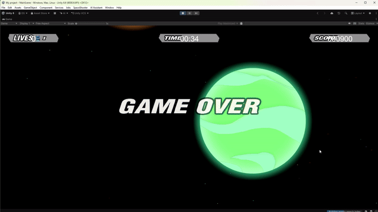

# 🚀 2D Space Shooter

A retro-style 2D Space Shooter arcade game developed in **Unity 6 (6000.6.6f1)** with C#, featuring animated spaceships, dynamic enemy spawning with homing projectiles, parallax scrolling backgrounds, and full desktop & mobile controls.

---

## 🎮 Gameplay Preview



> Full high-definition recordings are included in the repository:
> - **Web-optimized video**: [`media/gameplay_recording.mp4`](media/gameplay_recording.mp4)
> - **Original high-res recording**: [`media/Screen Recording 2026-11-13 012225.mp4`](media/Screen%20Recording%202026-11-13%20012225.mp4)

---

## ✨ Features

- **Player Mechanics**:
  - 8-directional smooth movement with screen boundary clamping.
  - Dual laser wing-mounted projectile cannons.
  - Audio-visual laser firing feedback.
  - Multi-input support: Keyboard (`WASD` / `Arrow Keys`), Accelerometer tilt, and on-screen touch button.
- **Enemy AI & Weapons**:
  - Downward patrolling enemy fighters with animated exhaust engines.
  - Onboard Enemy Gun targeting player coordinates with homing laser bullets.
  - Scaling difficulty curve (`EnemySpawner` progressively accelerates spawn rates).
- **Combat & Explosions**:
  - Frame-by-frame animated sprite sheet explosions with custom sound effects.
  - Precision 2D collision detection and tagging system.
- **Game Loop & State Manager**:
  - Complete state transitions: `Opening` (Title & Play), `Gameplay`, and `GameOver`.
  - 3-Lives HUD counter with hit feedback.
  - 6-digit score tracker (`000000`).
  - Elapsed survival timer (`mm:ss`).
- **Parallax Background**:
  - Procedural 4-color twinkling starfield generator (`StarGenerator`).
  - Cycling multi-layer planets (`planetBlue`, `planetGreen`, `planetPink`) drifting across space.

---

## 🕹️ Controls

| Action | PC / Keyboard | Mobile / Touch |
| :--- | :--- | :--- |
| **Move Left / Right** | `A` / `D` or `Left` / `Right` Arrow | Device Tilt (Accelerometer) |
| **Move Up / Down** | `W` / `S` or `Up` / `Down` Arrow | Device Tilt (Accelerometer) |
| **Fire Lasers** | `Spacebar` | Tap Red Shoot Button (bottom-right) |
| **Start Game** | Click **Play** Button | Tap **Play** Button |

---

## 💻 Running on Your Laptop (Optimized Setup)

This repository is optimized for quick cloning and lightweight portability.

### Option 1: Play Instantly (No Unity Installation Needed)
If you just want to play the game on your laptop without opening Unity:
1. Download or clone this repository.
2. Navigate to the [`Standalone_Build/`](Standalone_Build/) directory.
3. Extract **`SpaceShooter-Windows.zip`**.
4. Double-click **`SpaceShooter.exe`** to play!

### Option 2: Open and Edit in Unity Editor
If you want to view the source code, inspect scenes, or make edits:
1. Clone this repository:
   ```bash
   git clone https://github.com/Daud140/space-shooter.git
   ```
2. Open **Unity Hub**.
3. Click **Add** -> **Add project from disk**.
4. Select the **`SpaceShooter`** folder inside the cloned repo.
5. Open the project with **Unity 6** (`6000.6.6f1` or compatible).
6. In the Project window, navigate to `Assets/Scenes/` and double-click **`MainScene.unity`**.
7. Click the **Play button (`▶`)** at the top center to play!

---

## 📂 Repository Structure

```
space-shooter/
├── .gitignore                      # Standard Unity ignore rules (excludes heavy temporary cache)
├── README.md                       # Documentation & animated gameplay preview
├── media/                          # Gameplay preview GIF and recordings
│   ├── preview.gif
│   ├── gameplay_recording.mp4
│   └── Screen Recording 2026-11-13 012225.mp4
├── Standalone_Build/               # Portable pre-compiled game build
│   └── SpaceShooter-Windows.zip
└── SpaceShooter/                   # Unity Project Source
    ├── Assets/
    │   ├── Animations/             # Ship and explosion animation clips & controllers
    │   ├── Audio/                  # Background music & sound effects (wav / mp3)
    │   ├── Editor/                 # Automated project builder tools
    │   ├── Prefabs/                # Player, Enemy, Bullets, Explosion, Stars prefabs
    │   ├── Scenes/
    │   │   └── MainScene.unity     # Configured scene with complete game hierarchy
    │   ├── Scripts/                # C# gameplay scripts (Player, Enemy, UI, Manager)
    │   └── Sprites/                # 2D Sprite sheets and UI textures
    ├── Packages/
    │   └── manifest.json           # 2D Sprite, UGUI, and core dependencies
    └── ProjectSettings/            # Input manager, Tags, Layers, and Build settings
```

---

## 📜 Credits & License
- Project Architecture based on Charger Games' classic 2D Space Shooter tutorial.
- Developed by **Daud140**.
